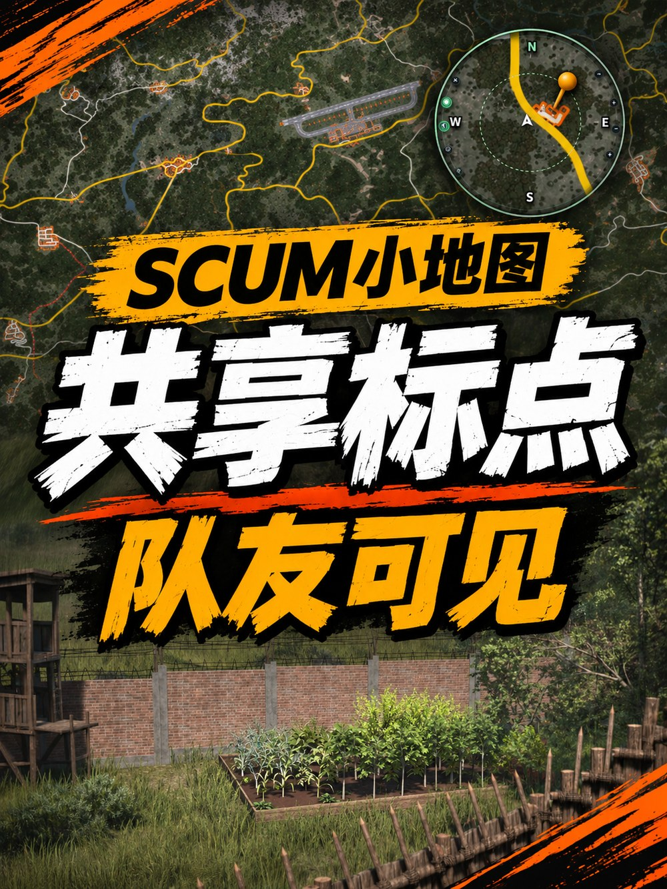
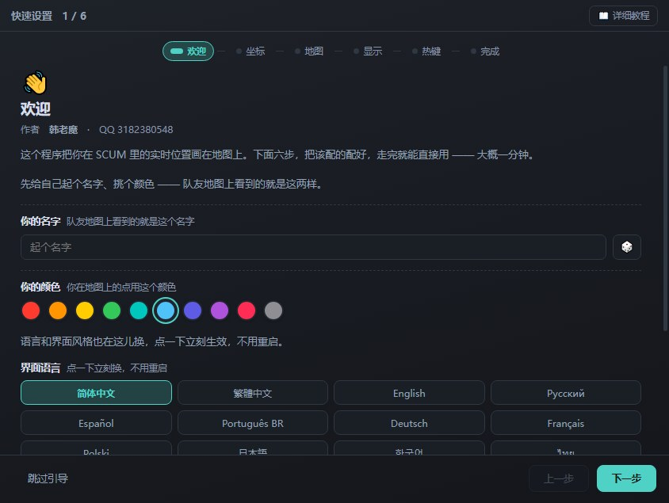

# SCUM 小地图

**常驻屏幕一角的实时战术雷达 —— 队友在哪、离你多远、该往哪走，一眼看见，不用再按 M 开大地图。**

最新版本 **v1.5.6**（2026-11-24） · Windows 10 / 11 · 免费 · 12 种语言

[**⬇ 下载最新版**](https://scumhan.github.io/scum-minimap/) · [完整功能说明](https://scumhan.github.io/scum-minimap/) · [反馈问题](https://github.com/scumhan/scum-minimap/issues)

---

## 这是什么

一个独立的小窗口，浮在 SCUM 游戏画面上，把你在岛上的实时位置画在地图里：红色三角是你，箭头指的方向就是你的面朝方向。圆形之外是透明的，鼠标移出去直接点到游戏里，不挡操作。

- **不读游戏内存**
- **不注入游戏进程**
- **不改游戏文件**
- **免费，不用注册**

坐标来自游戏自己写出的位置数据，程序只读不算，和游戏客户端没有交集。

## 主要功能

| 功能 | 说明 |
| --- | --- |
| 🎯 **实时定位与朝向** | 红色三角箭头跟着你走，箭头方向就是面朝方向，走到地图边缘会贴着边缘显示 |
| 👥 **多人联机** | 队友的位置、颜色、名字都画在同一张图上，谁在线、离你多远一目了然 |
| 📏 **距离环** | 以你为圆心画同心圆，米数自己填（默认 `100,200,500`），扫一眼就知道标点大概多远 |
| 🧭 **方位罗盘** | N / NE / E / SE / S / SW / W / NW 八方位 + 实时角度读数，可选地图随朝向旋转 |
| 📍 **标点与收藏** | 物资点、据点、队友标记随手打，**标点在队伍内共享，队友地图上同步可见**；常用位置收藏起来，下次直接看 |
| 🧭 **路线导航** | 点一个标点，自动算出一条路，按路线跑图不用边跑边找 |
| ⚔ **作战模式** | 一个热键切换「跑图态 / 战斗态」：地图放大 1.6 倍、物资点隐藏、准星自动开、音效自动关，退出时原样还原 |
| 🌙 **夜视滤镜** | 调显示器输出曲线把黑夜提亮（不动游戏内存、不注入），六根滑杆自己调 |
| 🖱 **鼠标穿透** | 圆外自动穿透；`Ctrl + Shift + L` 可全局穿透，地图彻底不吃鼠标 |
| 📸 **一键截图 / 坐标历史 / 死亡点** | 打点、复盘、找回死亡位置 |
| 🌐 **12 种语言** | 简体中文、繁體中文、English、Русский、Español、Português BR、Deutsch、Français、Polski、日本語、한국어、ไทย，设置里点一下即时切换 |
| 🗺 **高清底图** | 2048 / 4096 / 8192 三档按缩放自动切换，14×14 瓦片按需加载 |

## 下载安装

| 方式 | 地址 |
| --- | --- |
| **官网下载页（推荐）** | https://scumhan.github.io/scum-minimap/ |
| **GitHub Releases** | https://github.com/scumhan/scum-minimap/releases |

1. 下载 `SCUM-minimap-x.x.x-setup.exe`，双击安装，桌面会出现「SCUM 小地图」图标
2. 启动后是一个圆形悬浮窗，按住顶部程序名就能拖动，拖右下角小圆点调大小
3. 第一次启动跟着快速设置走一遍（起名字、挑颜色、选语言），大概一分钟

**老用户升级**：程序里「设置 → ⚙️ 系统 → 🔄 软件更新 → 检查更新」，只下 1.5M 左右的增量包，设置和标点都保留。启动 8 秒后也会静默查一次，有新版在托盘提示。

## 推荐服务器 · 5789 服务器

> 五个分区，从新手到硬核都有；抄家要挑战、炸家有保护、查挂从严。进服报 ID，直接连 IP 就行。

| 分区 | 定位 | 模式 | 物资倍率 | 直连 IP | QQ 群 |
| --- | --- | --- | --- | --- | --- |
| **5789·1服** | 🟢 新手推荐 | PVP + PVE | 基础物资 1× | `202.189.7.151:6002` | 808140002 |
| **5789·2服** | 🔴 打架抄家 | 纯 PVP | 基础 1× / 机场 10× | `202.189.7.151:6202` | 135578918 |
| **5789·3服** | 🟢 新手推荐 | 纯 PVE | 基础物资 1× | `202.189.7.151:6402` | 1028892300 |
| **5789·4服** | 🟣 硬核高难 | 纯 PVP 仿官 | 基础物资 0.2× | `202.189.7.151:6602` | 2169045995 |
| **5789·5服** | 🟣 硬核高难 | 纯 PVE | 基础物资 0.1× | `202.189.7.151:8002` | 1092608008 |

**怎么进服**：游戏主菜单 → 「直连 / Direct Connect」→ 粘贴上面的 IP 和端口。

**商城**（1～3 服）

- 1服：https://57891.scum8.com ｜ https://57891.scum.plus
- 2服：https://57892.scum8.com ｜ https://57892.scum.plus
- 3服：https://57893.scum8.com ｜ https://57893.scum.plus

**语音频道（KOOK）**：https://kook.vip/Lp1scY

**服规要点**

- **抄家要挑战**：1 服抄家必须向对方发起挑战并报备服主，双方画 24 小时红圈，第三方不得进圈干扰；2 服要求抄家方有 ≥1000 元素领地、小队资产占比 ≥50%
- **炸家保护**：2 服凌晨 2 点–上午 10 点、4 服凌晨 2 点–中午 12 点基地不可被炸毁；3 服（纯 PVE）全天保护
- **区域规则**：绿色圈是交易区绝对安全区，蓝色圈是新手村（有拳头伤害、不能建家），红色区埋雷无限制
- **撬锁要录屏**：撬锁全程录像并在 6 小时内传群文件，密码锁截图备注位置，漏录视为违规
- **查挂零容忍**：使用外挂永久 BAN 并上传社区联 BAN，拒绝配合查挂按开挂处理；举报请私聊管理，别发公屏

服务器信息由服主提供，人数、倍率、开服状态以游戏内实际显示为准。

## 想开服？联系作者

自己开一台 SCUM 服务器，作者可以从零帮你搭起来：服务器选型、开服参数、PVP / PVE 规则、反作弊、后台管理、定时重启备份，以及和小地图的对接。

**开服就送，不另外收费**：全套管理软件（后台面板、玩家管理、物资发放、白名单、封禁解封）、服务器日志（进出服、拿物资、击杀记录可查可导出）、萌新服主指南。

| 联系方式 | 号码 |
| --- | --- |
| QQ | `3182380548` |
| 微信 | `scumhan` |
| 邮箱 | `3182380548@qq.com` |

加好友备注一句「SCUM 开服」，通过得快一点。

## 说明

- 本工具为第三方辅助，与 SCUM 开发商 Gamepires 无关联
- 软件免费，不含任何付费解锁功能；不接受任何形式的二次售卖
- 坐标采集异常、地图校准、显示模式等问题，先看官网下载页的常见问题
- 版本更新记录见 [Releases](https://github.com/scumhan/scum-minimap/releases)

---

**作者：韩老魔** · QQ 3182380548 · 如果这个小工具帮你多活了几次，点个 ⭐ Star 就是最大的支持

