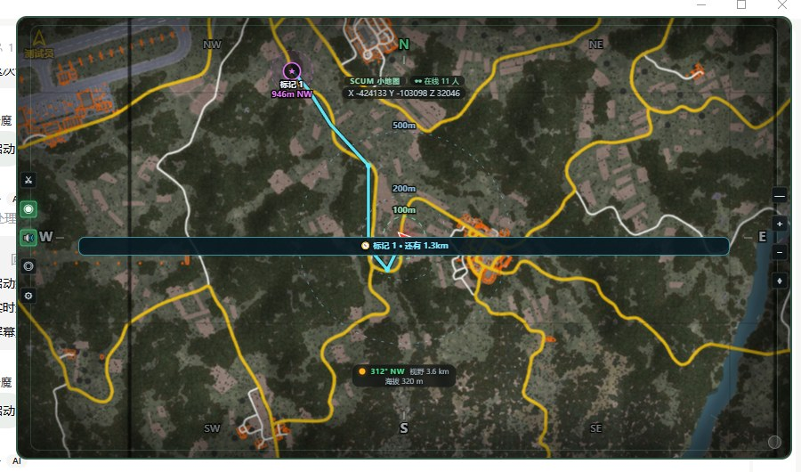

# SCUM 小地图

**常驻屏幕一角的实时战术地图。**
队友在哪、离你多远、该往哪走 —— 一眼看见，不用再按 M 开大地图。

A lightweight tactical map overlay for SCUM · Windows 10 / 11 · Free

 

 

**[⬇️ 下载最新版](https://scumhan.github.io/scum-minimap/)** ｜ [官网与教程](https://scumhan.github.io/scum-minimap/) ｜ [提交问题](https://github.com/scumhan/scum-minimap/issues) ｜ [English](#english)

---

## 这是什么

一个独立的小窗口，浮在 SCUM 游戏画面上，把你在岛上的实时位置画进地图：**红色三角是你，箭头指的方向就是你的面朝方向**。圆形之外是透明的，鼠标移出去直接点到游戏里，不挡操作。

| 🛡 不读游戏内存 | 🚫 不注入游戏进程 | 📁 不改游戏文件 | 🆓 免费 · 无需注册 |
| :---: | :---: | :---: | :---: |

坐标来自游戏自己写出的位置数据，程序只读不算，和游戏客户端没有交集。

## 主要功能

| | |
| :--- | :--- |
| 🎯 **实时定位与朝向** 箭头跟着你走，走到地图边缘会贴着边缘显示 | 👥 **多人联机** 队友的位置、颜色、名字画在同一张图上，谁在线、离你多远一目了然 |
| 📍 **标点与收藏** 物资点、据点随手打，**标点在队伍内共享**；常用位置收藏起来 | 🧭 **路线导航** 点一个标点，自动算出路线，按线跑图不用边跑边找 |
| 📏 **距离环** 以你为圆心画同心圆，米数自己填（默认 `100,200,500`） | 🧭 **方位罗盘** 八方位 + 实时角度读数，可选地图随朝向旋转 |
| ⚔ **作战模式** 一个热键切「跑图态 / 战斗态」：地图放大、物资点隐藏、准星自动开 | 🌙 **夜视滤镜** 调显示器输出曲线提亮黑夜，六根滑杆自己调，不动游戏内存 |
| 🖱 **鼠标穿透** 圆外自动穿透，`Ctrl + Shift + L` 可全局穿透，地图彻底不吃鼠标 | 📸 **截图 · 坐标历史 · 死亡点** 打点、复盘、找回死亡位置 |
| 🗺 **高清底图** 2048 / 4096 / 8192 三档按缩放自动切换，14×14 瓦片按需加载 | 🌐 **12 种语言** 简中、繁中、英、俄、西、葡、德、法、波、日、韩、泰，点一下即时切换 |

> 具体功能以当前版本为准。多人功能需要正确配置网络与频道信息。

## 界面

## 下载安装

| 方式 | 地址 |
| :--- | :--- |
| **官网下载页（推荐）** | https://scumhan.github.io/scum-minimap/ |
| **GitHub Releases** | https://github.com/scumhan/scum-minimap/releases |

1. 下载 `SCUM-minimap-x.x.x-setup.exe`，双击安装，桌面出现「SCUM 小地图」图标。
2. 启动后是一个圆形悬浮窗，按住顶部程序名拖动，拖右下角小圆点调大小。
3. 第一次启动跟着快速设置走一遍（起名字、挑颜色、选语言），大概一分钟。

**老用户升级**：设置 → ⚙️ 系统 → 🔄 软件更新 → 检查更新，只下 1.5 MB 左右的增量包，设置和标点都保留。启动 8 秒后也会静默查一次，有新版在托盘提示。

## 安全与兼容性

- 不读取游戏进程内存，不向游戏进程注入代码，不修改 SCUM 游戏文件。
- 坐标数据来自游戏自身生成的位置数据文件，由工具读取并显示。
- 游戏版本、系统权限、杀毒软件和本地网络环境可能影响运行，请以官网最新说明和实际测试结果为准。

## 问题反馈

遇到问题先看[官网常见问题](https://scumhan.github.io/scum-minimap/)，再来提：

- [🐛 提交 BUG](https://github.com/scumhan/scum-minimap/issues/new?template=bug_report.yml)
- [💡 功能建议](https://github.com/scumhan/scum-minimap/issues/new?template=feature_request.yml)
- [查看已有问题](https://github.com/scumhan/scum-minimap/issues)

提交时请附上软件版本、Windows 版本、复现步骤和截图。请勿上传账号密码、IP、个人路径等隐私信息。

## 社区服务器

> **5789 服务器**是作者运营的 SCUM 游戏社区，五个分区从新手到硬核都有。它与小地图软件**相互独立** —— 不加入也完全不影响工具使用。

服务器模式、倍率、直连 IP、商城、服规，以及**想自己开服**的搭建服务，都在独立页面：

**[→ 查看 5789 服务器信息](https://scumhan.github.io/scum-minimap/server.html)**

---

**作者：韩老魔**

[GitHub](https://github.com/scumhan) ｜ [项目仓库](https://github.com/scumhan/scum-minimap) ｜ [官网](https://scumhan.github.io/scum-minimap/)

如果这个小工具帮你多活了几次，点个 ⭐ Star 就是最大的支持。

SCUM 为其权利人所有。本项目是独立的第三方社区工具，与 Gamepires 无隶属或官方背书关系。

---

<b>🇬🇧 English</b> &nbsp;·&nbsp; click to expand

 

**A lightweight tactical map overlay for SCUM.**
Your position, your squad, your route — on screen, without opening the big map.

Windows 10 / 11 · Free · 12 languages

### What it is

A small standalone window that floats over SCUM and draws your live position on the island map: **the red triangle is you, the arrow points where you face**. Everything outside the circle is transparent, so your mouse clicks straight through to the game.

| 🛡 No memory reading | 🚫 No process injection | 📁 No game file changes | 🆓 Free, no account |
| :---: | :---: | :---: | :---: |

Position data comes from files the game itself writes; the tool only reads and displays it.

### Features

| | |
| :--- | :--- |
| 🎯 **Live position & heading** Follows you in real time, clamps to the map edge | 👥 **Squad sharing** Teammate positions, colors and names on one map |
| 📍 **Markers & favorites** Drop loot and POI markers, **shared with your team** | 🧭 **Route navigation** Pick a marker, get a route drawn on the map |
| 📏 **Distance rings** Concentric rings with custom radii (default `100,200,500`) | 🧭 **Compass** 8-way bearings, live angle, optional map rotation |
| ⚔ **Combat mode** One hotkey swaps travel / combat layout, zoom, crosshair | 🌙 **Night vision filter** Display-curve brightening, six sliders, no memory access |
| 🖱 **Mouse passthrough** Click-through outside the circle; `Ctrl + Shift + L` for full passthrough | 📸 **Screenshots & history** Coordinate log and death-point recovery |
| 🗺 **High-res basemap** 2048 / 4096 / 8192 tiers switched by zoom | 🌐 **12 languages** zh-CN, zh-TW, EN, RU, ES, PT-BR, DE, FR, PL, JA, KO, TH |

### Download & install

- **Official site (recommended):** https://scumhan.github.io/scum-minimap/
- **GitHub Releases:** https://github.com/scumhan/scum-minimap/releases

Download `SCUM-minimap-x.x.x-setup.exe`, run it, then follow the one-minute first-launch setup (name, color, language). Existing users can update in-app: Settings → System → Software update (incremental package, ~1.5 MB, settings and markers preserved).

### Safety & compatibility

The tool does not read game process memory, does not inject into the game process, and does not modify SCUM game files. Compatibility may depend on the game version, Windows configuration, security software and network environment.

### Feedback

- [🐛 Report a bug](https://github.com/scumhan/scum-minimap/issues/new?template=bug_report.yml)
- [💡 Request a feature](https://github.com/scumhan/scum-minimap/issues/new?template=feature_request.yml)
- [Browse existing issues](https://github.com/scumhan/scum-minimap/issues)

### Community server

The **5789** servers are a SCUM community run by the developer and are **independent** from this tool — joining is never required. Server modes, direct-connect IPs, store links, rules and server-hosting services live on a separate page:

**[→ 5789 server information](https://scumhan.github.io/scum-minimap/server.html)**

### Developer

**Han Laomo · 韩老魔** — [GitHub](https://github.com/scumhan) · [Repository](https://github.com/scumhan/scum-minimap) · [Website](https://scumhan.github.io/scum-minimap/)

SCUM is a trademark of its respective owner. This is an independent third-party community tool, not affiliated with or endorsed by Gamepires.

